<div align="center">



<br/>


### ✦ &nbsp;Serving the community, one page at a time&nbsp; ✦

[✦ About](#-about) &nbsp;·&nbsp; [✦ Run it](#-run-it-locally) &nbsp;·&nbsp; [✦ Structure](#-project-structure) &nbsp;·&nbsp; [✦ Contribute](#-contribute)

</div>



## ✦ About

**Madeena Welfare Society** is a website built by [@SyedRaqi](https://github.com/SyedRaqi). This repository holds its source: the pages, content and assets that make up the site.

The banner above is a real 3D object. An eight-pointed star is extruded, lit and rotated frame by frame using nothing but animated SVG: no GIFs, no scripts, no external images. The golden motes orbiting it and the slowly drifting geometric pattern behind it are SVG too.

<details>
<summary><b>✦ What's on the site</b> &nbsp;<i>(click to open)</i></summary>

<br/>

| ✦ | Section | Purpose |
| :-: | :--- | :--- |
| 🏠 | **Home** | The front door to the Society |
| 🤲 | **Our Work** | What the Society does for the community |
| 📞 | **Contact** | How to reach and support the Society |

> ✏️ *These rows are placeholders. Replace them with the site's real pages.*

</details>

## ✦ Run it locally

```bash
# 1. Clone the repository
git clone https://github.com/SyedRaqi/Demo.git

# 2. Step inside
cd Demo

# 3. Open the site in your browser
#    Double-click index.html, or serve the folder:
python -m http.server 8000
#    then visit http://localhost:8000
```

No build step is assumed. If the project adds a framework later, update these steps to match.

## ✦ Project structure

```text
Demo/
├── OneDrive/
│   └── Documents/
│       └── Anfal/        # site content and assets
├── LICENSE               # Unlicense: public domain
└── README.md             # you are here
```

## ✦ Contribute

Improvements are welcome.

1. **Fork** the repository
2. **Create** a branch: `git checkout -b feature/my-idea`
3. **Commit** your changes: `git commit -m "Add my idea"`
4. **Push** the branch: `git push origin feature/my-idea`
5. **Open** a pull request

## ✦ License

Released under the [Unlicense](LICENSE). It is free and unencumbered software, so use it however you like.


<div align="center">

**Madeena Welfare Society** &nbsp;✦&nbsp; Built by [Syed Raqi](https://github.com/SyedRaqi) &nbsp;✦&nbsp; If this helped, leave a ⭐

</div>
