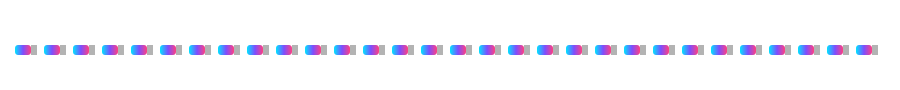

<div align="center">



<br/>


**The official website of the Madeena Welfare Society, brought to life in three dimensions.**

[About](#-about) · [Run it](#-run-it-locally) · [Structure](#-project-structure) · [Contribute](#-contribute)

</div>



## 🧊 About

**Madeena Welfare Society** is a website built by [@SyedRaqi](https://github.com/SyedRaqi). This repository holds its source: the pages, content and assets that make up the site.

The banner above is a rotating cube drawn entirely with animated SVG. No images, no GIFs, no scripts, just geometry that moves.

## ✨ What's inside

| Face | What you get |
| :--- | :--- |
| 🔷 **Front** | A clean, browser-ready website you can open straight away |
| 🟣 **Side** | Content and assets organised in their own folder |
| 🌸 **Top** | Open source under the Unlicense: use it, adapt it, share it |

> ✏️ *Replace this table with the site's real sections, for example About Us, Our Work, Donate or Contact.*

## 🚀 Run it locally

```bash
# 1. Clone the repository
git clone https://github.com/SyedRaqi/Demo.git

# 2. Step inside
cd Demo

# 3. Open the site in your browser
#    Double-click index.html, or serve the folder:
python -m http.server 8000
#    then visit http://localhost:8000
```

No build step is assumed. If the project adds a framework later, update these steps to match.

## 🗂️ Project structure

```text
Demo/
├── OneDrive/
│   └── Documents/
│       └── Anfal/        # site content and assets
├── LICENSE               # Unlicense: public domain
└── README.md             # you are here
```

## 🤝 Contribute

Ideas and fixes are welcome.

1. **Fork** the repository
2. **Create** a branch: `git checkout -b feature/my-idea`
3. **Commit** your changes: `git commit -m "Add my idea"`
4. **Push** the branch: `git push origin feature/my-idea`
5. **Open** a pull request

## 📜 License

Released under the [Unlicense](LICENSE). It is free and unencumbered software, so use it however you like.


<div align="center">

**Madeena Welfare Society** · Built by [Syed Raqi](https://github.com/SyedRaqi) · If this helped, drop a ⭐

</div>
